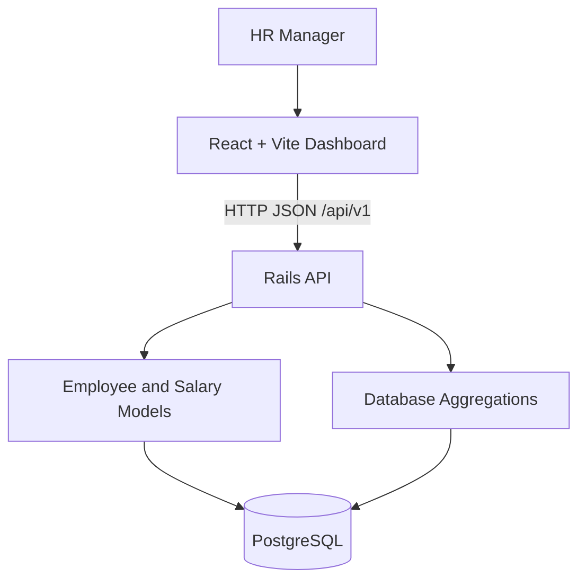

# SalaryFlow — Salary Management System

A salary management dashboard built for an HR Manager to browse employee records and review current salary information across multiple countries and currencies.

The application uses a React frontend, a Ruby on Rails JSON API, and PostgreSQL. It is designed to demonstrate practical engineering decisions around data modelling, filtering, pagination, analytics, testing, and maintainability.

## Features

- Seed dataset of 10,000 employees with current salary records.
- Employee directory with pagination, search, and filters for country, department, and employment status.
- Currency-specific salary analytics: employee count, average, minimum, and maximum salary.
- Employee breakdown by country, department, and employment status.
- Database-level aggregation and indexed employee fields.
- Automated Rails model and request tests.
- Responsive React dashboard with loading, error, retry, and empty states.

## Technology Stack

- Frontend: React, Vite, JavaScript, CSS
- Backend: Ruby on Rails API
- Database: PostgreSQL
- Testing: RSpec, Rails request and model specs
- Version control: Git

## Architecture



The frontend communicates with the Rails API through `/api`. During local development, Vite proxies these requests to `http://localhost:3000`.

The Rails application owns validation, filtering, pagination, and analytics. PostgreSQL performs record filtering, grouping, counting, and salary aggregation.

## Prerequisites

Install compatible versions of:

- Ruby 3.2.x
- Bundler
- Node.js and npm
- PostgreSQL

The project was developed with Ruby 3.2.2, Rails 7.2.x, Node.js 18.20.8, npm 10.8.2, and PostgreSQL 12.22. Use a Node.js release compatible with the installed Vite version.

## Local Setup

### 1. Clone the repository

```bash
git clone <YOUR_GITHUB_REPOSITORY_URL>
cd salary-management
```

Replace the placeholder with the actual repository URL.

### 2. Set up the backend

```bash
cd backend
bundle install
bin/rails db:create
bin/rails db:migrate
bin/rails db:seed
```

The seed task generates 10,000 deterministic employee records and their current salary records. Running the seed task again is designed to reuse the seeded employee codes and salary associations.

Ensure PostgreSQL is running and your local PostgreSQL role can create and access `backend_development` and `backend_test`.

### 3. Start the Rails API

From the `backend` directory:

```bash
bin/rails server -p 3000
```

The API will be available at `http://localhost:3000`.

### 4. Set up the frontend

Open a second terminal:

```bash
cd frontend
npm install
npm run dev
```

Open the local URL printed by Vite, usually `http://localhost:5173`. If that port is already occupied, Vite may choose another port.

### 5. Run the checks

Frontend lint:

```bash
cd frontend
npm run lint
```

Frontend production build:

```bash
npm run build
```

Backend tests:

```bash
cd backend
bundle exec rspec
```

## API Endpoints

All endpoints return JSON.

| Method | Endpoint | Purpose |
|---|---|---|
| GET | `/api/v1/employees` | Paginated employee directory |
| GET | `/api/v1/analytics/salary_summary` | Salary statistics grouped by currency |
| GET | `/api/v1/analytics/employee_breakdown` | Employee counts by country, department, and status |
| GET | `/up` | Rails health check |

### Employee directory query parameters

- `page`: page number; defaults to `1`.
- `per_page`: records per page; defaults to `20`, capped at `100`.
- `search`: matches employee code, first name, last name, or email.
- `country`: filters by country.
- `department`: filters by department.
- `status`: filters by employment status (`active`, `inactive`, or `on_leave`).

Example:

```bash
curl "http://localhost:3000/api/v1/employees?page=1&per_page=10&country=India"
```

Salary summary example:

```bash
curl "http://localhost:3000/api/v1/analytics/salary_summary"
```

Employee breakdown example:

```bash
curl "http://localhost:3000/api/v1/analytics/employee_breakdown"
```

The employee directory response contains `data` and pagination metadata in `meta`. Analytics responses contain aggregated data rather than requiring the frontend to calculate statistics from all employee records.

## Data Model

### Employee

Stores employee identity and organization information, including employee code, name, email, country, department, job title, and employment status.

### Salary

Stores the employee's current salary amount and currency. Each employee has at most one current salary record in this assessment's data model.

Employee codes and email addresses are unique. Salary records reference employees through a foreign key, and an employee can have only one salary record.

## Engineering Decisions and Trade-offs

- **Currency-aware analytics:** Salary values are grouped by currency. INR, USD, GBP, EUR, CAD, and AUD are not added together or compared as if they had the same value. Live foreign-exchange conversion is outside scope.
- **Database-level aggregation:** Counts and salary statistics are computed in PostgreSQL to avoid loading the full dataset into application memory.
- **Pagination:** The employee API limits page size to 100 records and returns pagination metadata.
- **Indexes:** Employee code and email have unique indexes; country, department, status, and salary currency have indexes for common lookups and reporting.
- **Current salary only:** Salary history and effective dates were excluded because current salary is sufficient for the stated assessment.
- **Single HR persona:** Authentication and role management were excluded following the assessment clarification.
- **No microservices:** A modular Rails API and React frontend are sufficient for this application's scope and avoid unnecessary operational complexity.
- **No permanent deletion:** Destructive employee deletion is not part of the assessment's required workflow.

Detailed scope and requirements are documented in [`docs/requirements.md`](docs/requirements.md).

## Testing

The backend test suite includes model validation and API request coverage for employee listing, filtering, pagination, and analytics.

The frontend has ESLint checks and a production build check.

Run all checks using the commands in the Local Setup section. Add new tests when changing API behavior or data validation.

## AI-Assisted Development

AI assistance was used during development for implementation guidance, code review, debugging, test planning, and documentation drafting. Generated suggestions were reviewed against the application's requirements and verified with local API checks, the RSpec suite, frontend linting, and a production build.

The implementation decisions, scope exclusions, and final code remain the candidate's responsibility and should be explainable during review.

## Limitations and Future Improvements

- Add frontend component and interaction tests.
- Add API request validation and consistent error responses for invalid filter values.
- Add employee create/update forms if required by the final product scope.
- Add production deployment configuration, monitoring, and environment-specific database configuration.
- Add salary history only if future requirements need historical compensation analysis.

## Project Status

Local employee and analytics workflows have been implemented and verified. Public deployment and a demo recording should be linked here once available.

- Live application: Not deployed yet
- Demo video: Not recorded yet
